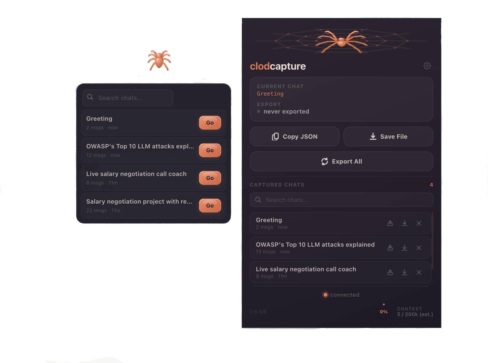
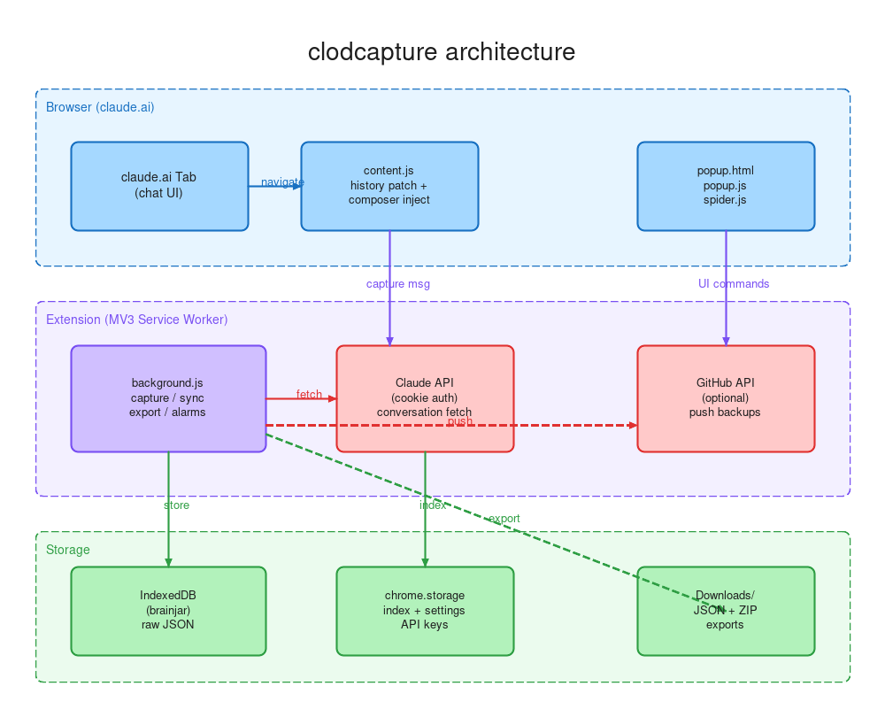

<p align="center">
  
</p>

<h1 align="center">clodcapture</h1>

<p align="center">
  <em>Auto-save, export, and continue Claude.ai chat sessions across conversations</em><br />
  <em>Zero dependencies, zero accounts, all data stays local</em>
</p>

<p align="center">
  <a href="https://chromewebstore.google.com/detail/mhapejnhlmepeinjmlppoopcoicmgojb"></a>
  <a href="https://github.com/freyzo/clodcapture"></a>
  <a href="https://clodcapture-privacy.vercel.app/"></a>
</p>

---

## About

**Problem**

- Claude.ai has no full session export. When context fills up, long threads are hard to keep.
- Manual copy-paste loses structure, and there's no way to resume a prior conversation in a new chat without friction.
- You can't see how much context you've used until it's too late.

**Solution**

- **clodcapture** runs while you use claude.ai. No separate login, no setup.
- Captures full conversation JSON automatically as you navigate between chats.
- One-click export, bulk sync, GitHub backup, and session continuation in new chats.

**Summary**

| You want | How |
| --- | --- |
| Auto-capture a chat | Just visit it - clodcapture captures on navigation |
| Copy session to clipboard | Click **Copy** in popup |
| Download raw JSON | Click **Grab** |
| Export everything | Click **Export All** - zips to `Downloads/clodcapture/` (split into ~64 MB parts for large libraries) |
| Resume in a new chat | Click the continue button on any captured chat |
| Quick continue (FAB) | Click the floating spider button on claude.ai |
| Continue from a summary instead of the full chat | Switch the panel to **Key** mode, then **Go** |
| Select a range to continue | Use the timeline spine to pick specific messages |
| Combine multiple chats | Long-press to multi-select, continue with stacked keys |
| Continue a whole project | Click a project chip in the panel, then **Go with keys** |
| Organize chats | Edit tags in the panel (**+** to add, **×** to remove, with **Undo**), search with `#tag` |
| Delete a chat | Click **×** in the popup list - it goes right away, with **Undo** for a few seconds |
| Restore chats / move to another browser | Settings → **Import…** - pick Export All zips, saved `.json` files and/or a keys file (several at once) |
| Move keys to another browser | Settings → **Export keys**, then **Import…** on the other side |
| Push to GitHub | Configure repo in Settings, click **Push All** |
| See context usage | Check the gauge in the popup footer or the FAB ring |

---

## UI

<p align="center">
  
</p>

## Install

[Download from Chrome Web Store](https://chromewebstore.google.com/detail/mhapejnhlmepeinjmlppoopcoicmgojb)

### From source

1. Clone this repo.
2. Chrome -> **Extensions** -> turn on **Developer mode** -> **Load unpacked** -> choose the repo folder (the one with `manifest.json`).
3. Open https://claude.ai and use the extension popup.

---

## How it works

### Capture pipeline

1. Content script listens for claude.ai's in-app navigation (Navigation API `currententrychange`) and tab URL changes. Switching chats triggers a capture via the service worker.
2. Uses your existing claude.ai session cookies to call the conversation API. No API key required for saving.
3. Raw JSON stored in **IndexedDB** (`brainjar`). Metadata indexed in `chrome.storage.local` for fast popup rendering.
4. Background alarm checks every **30 minutes** and re-downloads only chats whose `updated_at` changed.

### clawd-continue (session resume)

Resume a saved thread in a new chat:

1. Distills captured JSON to `{ role, text }` pairs.
2. **With API key:** Claude Sonnet builds an intelligence report (entities, arc, state, next step) - not a line-by-line replay.
3. **Without API key:** Fallback prompt embeds session JSON directly.
4. Opens a new chat (`/new`) and injects into the composer via `ClipboardEvent`. The text is handed across the page load through extension storage, so it also works when you start from inside another chat.

### Context usage gauge

- **With API key:** exact token count via `/v1/messages/count_tokens` against a 200k window.
- **Without:** estimate via `chars / 3.5`.
- Shown as a segmented ring in the popup footer.

### Floating Action Button (FAB)

A draggable jelly spider button injected directly onto claude.ai. Click to open a mini-panel with your recent captured chats. One click to continue any session in a new chat. Toggle with **Cmd+Shift+K**.

The panel and toasts follow claude.ai's own light/dark appearance (the popup follows the system). With **Reduce Motion** on, the FAB, panel, spine and popup stop animating and the spider is drawn still. Otherwise animations rest after a few seconds, and hidden tabs do no polling.

The panel's **Go uses** switch picks how **Go** continues: **Full** opens the timeline spine; **Key** continues straight from the chat's summary key. Chats you continued show where they came from (`↳ parent chat`).

### Timeline Spine

Click "Go" on any chat in the FAB panel (Full mode) to open the timeline spine - a vertical scrubber showing every message as a proportional marker (orange = human, purple = assistant; past 100 messages, markers are grouped). Drag the handles to select a range. Quick-select chips: Last 10, Last 25, 2nd half, **Since break** (after the longest pause of 30+ minutes), All. Zoom with the **1×** chip or pinch / Ctrl+scroll on the bar. The chat's first 2 messages are always carried along for context. Live token estimate, or an **exact** count with an API key. Only your selected slice gets injected into the new chat.

### Portable Chat Keys

Each chat can generate a compact summary key (~500 tokens) via Haiku. With an API key, keys are built automatically for chats you open (at most one call every 10 seconds) and rebuilt when the chat changes. Keys contain: summary, entities (people, tools, files, decisions), arc, tags, current state, and next step. Long-press chat items to multi-select up to 5 sessions, then "Go with keys" to stack all their summaries into one new chat. Auto-tags show as colored pills, are searchable with `#tag-name`, and can be edited (your edits survive key rebuilds). Chats that share 2+ tags or are linked by a continue form a **project**; click its chip to select it. Export / import all keys from Settings.

---

## Architecture

<p align="center">
  
</p>

```
manifest.json            MV3 service_worker + content_scripts on claude.ai
  +-- background.js      capture, sync, export, GitHub push, alarms,
  |                       spine indexing, key generation, token count
  +-- content.js         history patching, capture triggers, composer injection
  +-- fab.js             floating action button, panel, chat list
  +-- spine.js           timeline scrubber, range selection, partial continue
  +-- keys.js            portable keys, tag editing, projects, multi-select
  +-- fab.css + spine.css styles for FAB, panel, spine, tags, liquid buttons
  +-- popup.html/js      popup UI, settings, import (zip/json/keys), undo, full chat list
  +-- spider.js          3D spider canvas animation (click = bounce)
```

Zero runtime dependencies. ~1000 lines across 7 JS files.

---

## Permissions

| Permission | Why |
| --- | --- |
| `storage`, `unlimitedStorage` | IndexedDB + extension storage for captured sessions |
| `tabs` | Detect active claude.ai tab and extract chat ID from URL |
| `cookies` | Session-backed API calls for capture (no cookies stored or transmitted) |
| `downloads` | JSON and ZIP exports to Downloads folder |
| `clipboardWrite`, `clipboardRead` | Copy/paste workflows for session data |
| `scripting` | Inject content script for composer loading |
| `alarms` | 30-minute background sync |

**Host permissions:** `claude.ai` (capture), `api.anthropic.com` (optional token counting + continue), `api.github.com` (optional backup).

---

## Settings

| Setting | What it does |
| --- | --- |
| **API key** | Enables exact token counting, automatic summary keys, and AI-powered session digests via clawd-continue |
| **GitHub repo** | `owner/repo` for backup. Push captured sessions as versioned JSON files |
| **Auto-push** | Automatically push to GitHub on every capture |
| **Backup & Restore** | **Export keys** saves every chat key as one JSON file. **Import…** restores chats from Export All zips or saved `.json` files and keys from a keys file. A newer local copy is never overwritten |

All settings stored locally in `chrome.storage.local`. No data leaves your machine unless you configure GitHub backup or an API key (chat text is then sent to `api.anthropic.com` for digests, keys and token counts).

---

<p align="center">
  <a href="https://freyazou.com">freyazou.com</a> · <a href="https://x.com/freyazou">@freyazou</a> · <a href="https://www.linkedin.com/in/freya-zou-068615252/">LinkedIn</a> · <a href="https://www.youtube.com/channel/UC9pdMpmZ6ZNAakfcZSxaJXQ">YouTube</a>
</p>
