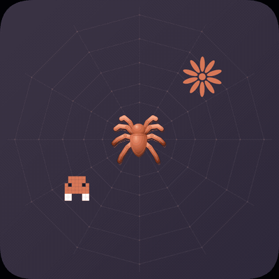

<p align="center">
  
</p>

<h1 align="center">clodcapture</h1>

<p align="center">
  <em>Auto-save, export, and continue Claude.ai chat sessions</em><br/>
  <em>Background capture, local storage, version history</em>
</p>

<p align="center">
  <a href="https://chromewebstore.google.com/detail/mhapejnhlmepeinjmlppoopcoicmgojb">Chrome Web Store</a>
  ·
  <a href="https://clodcapture-privacy.vercel.app/">Privacy</a>
  ·
  <a href="https://freyazou.com/projects/clodcapture/">Project page</a>
</p>

**Install from the Chrome Web Store** (recommended):

[clodcapture on Chrome Web Store](https://chromewebstore.google.com/detail/mhapejnhlmepeinjmlppoopcoicmgojb)

Current live version: **2.2.0**. After you submit an update, the listing may show “pending review” for a while.

---

## About

**Problem**

- Claude.ai has no full session export — long threads are hard to keep when context fills up.
- Manual copy-paste is slow and you lose structure (roles, metadata, ordering).
- You want chats **saved locally** while you work, with a way to **export** or **continue** in a new conversation later.

**Solution**

- **`clodcapture`** is a Chrome extension that runs on **claude.ai**:
  - **Auto-capture** when you switch chats (uses your existing site session — no API key required to save).
  - **Local storage** — full JSON in IndexedDB; fast list metadata in extension storage.
  - **Export** — copy distilled JSON, download raw API JSON, sync all to disk, or push to GitHub.
  - **clawd-continue** — resume a saved thread in a new chat via an intelligence report (with optional API key).
- Optional **Anthropic API key** for token counting and smarter continue prompts. Capture itself uses cookies only.

**Summary**

| You want | Where / how |
| --- | --- |
| Install (users) | [Chrome Web Store](https://chromewebstore.google.com/detail/mhapejnhlmepeinjmlppoopcoicmgojb) |
| Auto-save while chatting | Open claude.ai — extension captures on navigation |
| See saved chats | Extension popup list |
| Copy distilled JSON | Popup → **Copy** |
| Download raw capture | Popup → **Grab** |
| Export everything | Popup → **Sync All** → `Downloads/clodcapture/` |
| Backup to GitHub | Configure repo in settings → **GitHub Push** |
| Continue in new chat | Popup → **clawd-continue** |
| Context usage gauge | Popup ring (API key = exact tokens; else char estimate) |

> Requires **Chrome** (Manifest V3) and an active **claude.ai** session.

---

## Install

1. Open the [Chrome Web Store listing](https://chromewebstore.google.com/detail/mhapejnhlmepeinjmlppoopcoicmgojb).
2. Click **Add to Chrome**.
3. Open https://claude.ai and click the extension icon.

---

## Usage

### Everyday loop

1. Use Claude normally on **claude.ai** — chats capture in the background when you switch threads.
2. Open the popup to browse saved sessions, export, or continue.
3. Background alarm refreshes captures every **30 minutes**.

### Export modes

| Mode | Behavior |
| --- | --- |
| **Copy** | Distills to `{ title, messages[] }` JSON → clipboard |
| **Grab** | Downloads raw API JSON (timestamped filename) |
| **Sync All** | Exports every capture to `Downloads/clodcapture/` |
| **GitHub Push** | Pushes to configured `owner/repo` (optional auto-push on capture) |

### clawd-continue

Resume a saved thread in a **new** chat:

1. Distills capture to roles + text.
2. **With API key:** Claude Sonnet builds an **intelligence report** (entities, arc, state, next step) — not a line-by-line replay.
3. **Without API key:** Fallback prompt embeds session JSON.
4. Injects into the claude.ai composer via `ClipboardEvent`.

### Context gauge (popup)

- **With API key:** `/v1/messages/count_tokens` vs **200k** window.
- **Without:** estimate `chars / 3.5`.
- Shown as a dashed ring in the popup.

### Examples

```text
# Typical flow
1. Chat on claude.ai (auto-captured)
2. Open popup → pick a session → Copy or Grab
3. New chat → clawd-continue → paste injected prompt

# Bulk export
Popup → Sync All → check ~/Downloads/clodcapture/

# GitHub backup (after configuring owner/repo in settings)
Popup → GitHub Push on one chat, or enable auto-push on capture
```

---

## Demo

<p align="center">
  
</p>

---

## How it works

### Capture pipeline

1. **Content script** patches `history.pushState` / `replaceState` and listens for `popstate`.
2. Chat switch → message to **service worker** → fetch conversation API with session cookies.
3. Raw JSON → **IndexedDB** (`brainjar`); metadata → `chrome.storage.local` for the popup list.
4. **Alarm** every 30 minutes re-syncs open/recent chats.

### Architecture

```
manifest.json          MV3, service_worker, content_scripts on claude.ai
  |
  +-- background.js    IndexedDB, auth fetch, capture / sync / export,
  |                     GitHub push, token count, alarms
  +-- content.js       History patching, capture triggers, composer injection
  +-- popup.js         UI, handlers, settings, lists, progress
  +-- popup.html       Layout + styles (glass UI)
  +-- spider.js        Header canvas spider (click = bounce)
```

### Design

- Accent **#D97757** (terracotta): progress, badges, gauge, spider, status dots.
- Dark glass UI, blur, springy easing `cubic-bezier(.34,1.56,.64,1)`.
- Typography: **DM Sans** (400 / 500 / 700).

---

## Permissions

| Permission | Why |
| --- | --- |
| `storage`, `unlimitedStorage` | IndexedDB + extension storage |
| `tabs` | Active claude.ai tab / chat id from URL |
| `cookies` | Session-backed API calls for capture |
| `downloads` | JSON exports |
| `clipboardWrite`, `clipboardRead` | Copy / paste workflows |
| `scripting` | Inject for composer flows |
| `alarms` | 30-minute sync |

**Host permissions:** `claude.ai`, `api.anthropic.com` (counting / continue), `api.github.com` (backup).

---

## Privacy

- Data stays **on your machine** unless you export or configure GitHub push.
- See the [privacy policy](https://clodcapture-privacy.vercel.app/) linked from the store listing.
- Store listing states data is not sold or used for unrelated purposes.

---

## Contact

<p align="center">
  <a href="https://x.com/freyazou">X @freyazou</a>
  ·
  <a href="https://github.com/freyzo">GitHub</a>
  ·
  <a href="https://www.linkedin.com/in/freyazou/">LinkedIn</a>
  ·
  <a href="https://freyazou.com/">Website</a>
</p>
