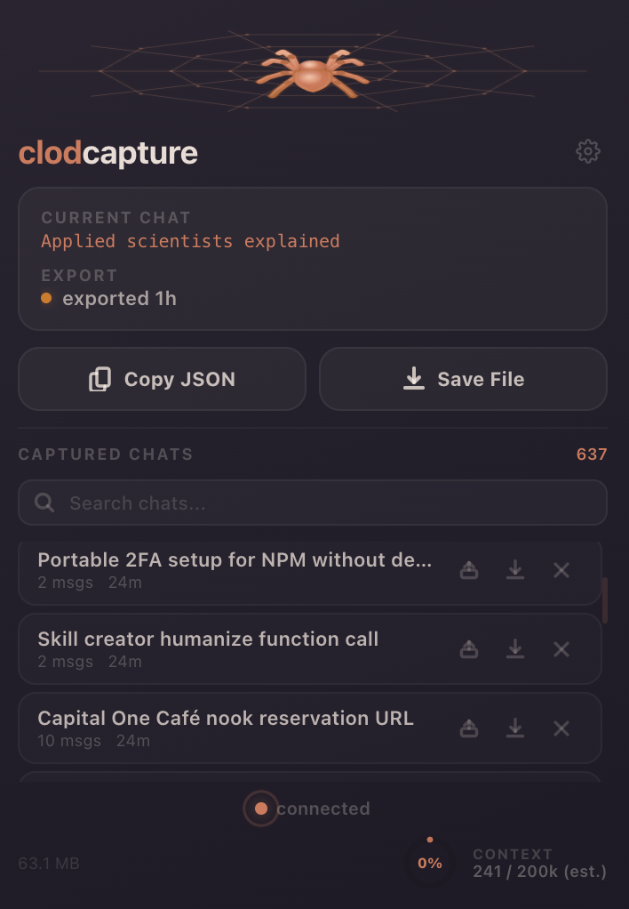
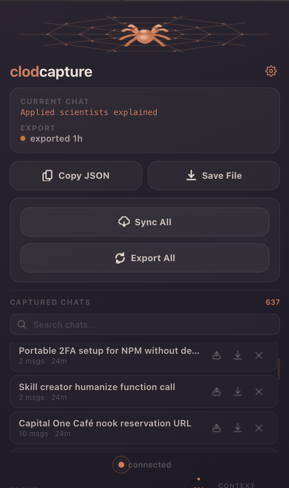

  

<h1 align="center">clodcapture</h1>

  <em>Export your Claude chat data from claude.ai</em>

  
  
  

---

## What it does

Claude.ai doesn't let you export full sessions, and when context fills up you lose the thread. clodcapture fixes that.

It runs in the background while you use Claude. Chats are captured automatically as you navigate between them - full conversation JSON, stored locally in your browser. Nothing leaves your machine unless you tell it to.

## Features

- **Auto-capture** - just visit a chat and it's saved. Background sync every 30 min catches anything you missed.
- **Sync All** - one click to pull every conversation from your account on demand.
- **Continue in new chat** - resume any saved session with an AI-generated digest.
- **Timeline spine** - pick exactly which messages to carry forward with a visual scrubber.
- **Portable keys** - compact AI-generated summaries (~500 tokens each). Stack up to 5 into one new chat.
- **Export** - copy JSON, download individual files, or bulk-export everything as a zip.
- **Context gauge** - see how much of the 200k window you've used.
- **Floating spider button** - a draggable FAB on claude.ai for quick access to recent chats. Toggle with Cmd+Shift+K.
- **Tags and projects** - auto-generated tags, editable, searchable with `#tag`. Related chats group into projects.
- **Light/dark mode** - follows claude.ai's appearance. Respects Reduce Motion.

  
  &nbsp;&nbsp;
  

## Install

[Chrome Web Store](https://chromewebstore.google.com/detail/mhapejnhlmepeinjmlppoopcoicmgojb)

From source:

1. Clone this repo.
2. Chrome -> Extensions -> Developer mode on -> Load unpacked -> pick the folder with `manifest.json`.
3. Open claude.ai.

## Optional setup

An API key unlocks exact token counts and smarter continue digests. Set it in background.js or via the extension's storage. Optional - everything works without it.

---

  <a href="https://freyazou.com">freyazou.com</a> · <a href="https://x.com/freyazou">@freyazou</a> · <a href="https://www.linkedin.com/in/freya-zou-068615252/">LinkedIn</a> · <a href="https://www.youtube.com/channel/UC9pdMpmZ6ZNAakfcZSxaJXQ">YouTube</a>

