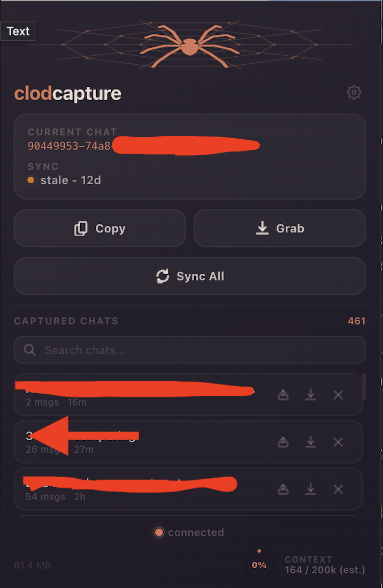

  

<h1 align="center">clodcapture</h1>

  <em>Auto-save, export, and continue Claude.ai chat sessions across conversations</em> 
  <em>Zero dependencies, zero accounts, all data stays local</em>

  
  
  

---

## About

**Problem**

- Claude.ai has no full session export. When context fills up, long threads are hard to keep.
- Manual copy-paste loses structure, and there's no way to resume a prior conversation in a new chat without friction.
- You can't see how much context you've used until it's too late.

**Solution**

- **clodcapture** runs while you use claude.ai. No separate login, no setup.
- Captures full conversation JSON automatically as you navigate between chats.
- One-click export, bulk sync, GitHub backup, and session continuation in new chats.

**Summary**

| You want | How |
| --- | --- |
| Auto-capture a chat | Just visit it - clodcapture captures on navigation |
| Copy session to clipboard | Click **Copy** in popup |
| Download raw JSON | Click **Grab** |
| Export everything | Click **Sync All** - zips to `Downloads/clodcapture/` |
| Resume in a new chat | Click the continue button on any captured chat |
| Push to GitHub | Configure repo in Settings, click **Push All** |
| See context usage | Check the gauge in the popup footer |

---

## UI

  

## Install

[Download from Chrome Web Store](https://chromewebstore.google.com/detail/mhapejnhlmepeinjmlppoopcoicmgojb)

### From source

1. Clone this repo.
2. Chrome -> **Extensions** -> turn on **Developer mode** -> **Load unpacked** -> choose the repo folder (the one with `manifest.json`).
3. Open https://claude.ai and use the extension popup.

---

## How it works

### Capture pipeline

1. Content script patches `history.pushState` / `replaceState` and listens for `popstate`. Switching chats triggers a capture via the service worker.
2. Uses your existing claude.ai session cookies to call the conversation API. No API key required for saving.
3. Raw JSON stored in **IndexedDB** (`brainjar`). Metadata indexed in `chrome.storage.local` for fast popup rendering.
4. Background alarm refreshes captures every **30 minutes**.

### clawd-continue (session resume)

Resume a saved thread in a new chat:

1. Distills captured JSON to `{ role, text }` pairs.
2. **With API key:** Claude Sonnet builds an intelligence report (entities, arc, state, next step) - not a line-by-line replay.
3. **Without API key:** Fallback prompt embeds session JSON directly.
4. Injects into the claude.ai composer via `ClipboardEvent`.

### Context usage gauge

- **With API key:** exact token count via `/v1/messages/count_tokens` against a 200k window.
- **Without:** estimate via `chars / 3.5`.
- Shown as a segmented ring in the popup footer.

---

## Architecture

  

---

## Permissions

| Permission | Why |
| --- | --- |
| `storage`, `unlimitedStorage` | IndexedDB + extension storage for captured sessions |
| `tabs` | Detect active claude.ai tab and extract chat ID from URL |
| `cookies` | Session-backed API calls for capture (no cookies stored or transmitted) |
| `downloads` | JSON and ZIP exports to Downloads folder |
| `clipboardWrite`, `clipboardRead` | Copy/paste workflows for session data |
| `scripting` | Inject content script for composer loading |
| `alarms` | 30-minute background sync |

**Host permissions:** `claude.ai` (capture), `api.anthropic.com` (optional token counting + continue), `api.github.com` (optional backup).

---

## Settings

| Setting | What it does |
| --- | --- |
| **API key** | Enables exact token counting and AI-powered session digests via clawd-continue |
| **GitHub repo** | `owner/repo` for backup. Push captured sessions as versioned JSON files |
| **Auto-push** | Automatically push to GitHub on every capture |

All settings stored locally in `chrome.storage.local`. No data leaves your machine unless you explicitly configure GitHub backup.

---

  <a href="https://freyazou.com">freyazou.com</a> · <a href="https://x.com/freyazou">@freyazou</a> · <a href="https://www.linkedin.com/in/freya-zou-068615252/">LinkedIn</a> · <a href="https://www.youtube.com/channel/UC9pdMpmZ6ZNAakfcZSxaJXQ">YouTube</a>

